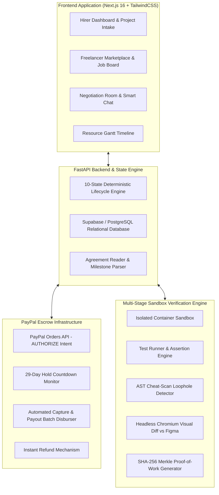

# PactPal

<div align="center">

  <h1>Zero-Trust Multimodal Escrow Referee for Digital Freelancing</h1>

  <p>
    <strong>Autonomous AI-Driven Milestones • 29-Day PayPal Escrow Holds • Isolated Sandbox Verification • Cryptographic Proof-of-Work Receipts</strong>
  </p>

  <div>
    
    
    
    
    
    
    
  </div>

  <br />

  <p>
    <a href="https://pactpal-frontend-c0mh.onrender.com"><strong>Explore Live Frontend</strong></a> •
    <a href="https://pactpal-backend.onrender.com/docs"><strong>Interactive Swagger API Docs</strong></a> •
    <a href="#system-architecture"><strong>Architecture</strong></a> •
    <a href="#hirer--freelancer-lifecycle"><strong>How It Works</strong></a> •
    <a href="#team--contributions"><strong>The Team</strong></a>
  </p>

</div>

---

## 1. Executive Summary & Problem

Freelance software engineering and digital milestone deliveries suffer from a severe **bilateral trust deficit**:

- **Hirers (Clients)** risk paying upfront for non-functional code, skipped acceptance criteria, hardcoded mock data, or abandoned repositories.
- **Freelancers (Developers)** risk non-payment, chargebacks, scope creep, and payment disputes after investing days or weeks of manual engineering.

**PactPal solves this by removing subjective human bias.** It acts as an impartial, automated **AI Escrow Referee** that:
1. Deconstructs agreements into a **priced checklist** where every feature has a strict mathematical percentage weight and a machine-verifiable acceptance test.
2. Freezes the project budget upfront in **PayPal Escrow** using the `AUTHORIZE` intent (locking funds safely for up to 29 days without premature debit).
3. Executes and verifies submitted code inside an **isolated container sandbox** (running dependency checks, unit tests, AST cheat-scan detectors, and headless visual diffs against Figma specifications).
4. Automatically disburses **proportional payouts** for verified milestones, processes instant refunds for failed criteria, and generates an immutable **SHA-256 Proof-of-Work Receipt**.

---

## 2. Core Architectural Pillars



---

## 3. How Hirer & Freelancer Workflows Function

PactPal enforces strict role separation so neither party can compromise the other's decisions or impersonate them in arbitration.

```mermaid
sequenceDiagram
    autonumber
    actor Hirer as 👔 Hirer (Client)
    participant PactPal as ⚖️ PactPal Platform
    actor Freelancer as 🧑‍💻 Freelancer
    participant PayPal as 💳 PayPal Escrow Sandbox
    participant Sandbox as 🛡️ Verification Sandbox

    Hirer->>PactPal: 1. Posts project with priced milestone checklist
    Freelancer->>PactPal: 2. Browses available jobs & submits proposal / application
    Hirer->>PactPal: 3. Accepts proposal; enters Contract Review & negotiation
    Hirer->>PactPal: 4. Dual-signs contract terms
    Freelancer->>PactPal: 5. Dual-signs contract terms
    Note over PactPal: Status transitions to SIGNED
    Hirer->>PayPal: 6. Authorizes project budget via PayPal (Hold placed)
    PayPal-->>PactPal: Webhook confirms funds locked (Status: FUNDED)
    Note over Freelancer: Contract moves to Active Contracts; dev starts
    Freelancer->>PactPal: 7. Submits deliverable (Git Repo URL, Commit SHA, Branch)
    Note over PactPal: Status transitions to DECISION / VERIFYING
    PactPal->>Sandbox: 8. Spawns sandbox: builds code, runs tests, AST scan & Figma diff
    Sandbox-->>PactPal: 9. Returns verification verdict (% passed)
    alt Milestones Passed (e.g. 100%)
        PactPal->>PayPal: 10a. Executes Capture & releases payout to Freelancer
        PactPal-->>Freelancer: Funds credited to PayPal
    else Partial / Disputed Delivery
        PactPal->>PayPal: 10b. Releases pro-rata payout for passed items & refunds remainder to Hirer
        PactPal->>PactPal: 10c. Logs case in Dispute Arbitration Room
    end
    PactPal->>Hirer: 11. Issues cryptographic Proof-of-Work Receipt (SHA-256)
    PactPal->>Freelancer: 11. Issues cryptographic Proof-of-Work Receipt (SHA-256)
```

### Flow Breakdown

#### Phase 1: Project Posting & Smart Milestones
- The Hirer defines project scope, deadline, and total budget.
- Features are configured with **percentage weights** (must total exactly 100%) and **clear acceptance test criteria**.
- Once posted, the project appears in the public Freelancing section (hidden from the Hirer's own freelancing feed to prevent self-bidding).

#### Phase 2: Application & Review
- Freelancers browse unassigned projects, review milestone tests, and apply.
- Parties enter the **Negotiation Room** with real-time chat.
- Both parties review the priced checklist. Either party can submit counter-offers (price, deadline, feature weight reallocation) before locking.
- Once agreed, both parties stamp **Dual-Sign Confirmation**.

#### Phase 3: PayPal Escrow Authorization (Hirer-Protected)
- Only the **Hirer** sees the payment action button.
- The Hirer authorizes the project total via **PayPal Orders v2** using `AUTHORIZE` mode.
- Money is not transferred to the freelancer yet—it is secured in an escrow hold for up to 29 days.
- The contract automatically transitions to **FUNDED** and moves into both users' active dashboards.

#### Phase 4: Delivery Intake & Sandbox AI Referee
- The Freelancer pushes code to GitHub and submits the **Repository URL**, **Commit SHA**, and **Branch**.
- PactPal spins up an isolated sandbox to run the multi-stage verification pipeline:
  - **Stage A (Intake & Environment)**: Clones pinned commit SHA and builds in a zero-network-leak container.
  - **Stage B (Test Runner)**: Executes unit and integration test assertions against acceptance criteria.
  - **Stage C (AST Cheat-Scan)**: Scans Abstract Syntax Trees for hardcoded mock returns, fake auth tokens, or bypassed logic.
  - **Stage D (Visual Diff)**: Renders live DOM screenshots and compares them against target Figma specifications.
  - **Stage E (Scoring)**: Computes weighted milestone pass rate.

#### Phase 5: Automated Settlement & Tamper-Evident Receipt
- **Passing Milestones**: Escrow capture releases funds directly to the Freelancer's PayPal balance.
- **Failing Milestones**: Unfulfilled weight amounts are refunded back to the Hirer's payment source.
- An immutable **Proof-of-Work Receipt** is minted with SHA-256 payload digests, execution logs, and transaction IDs.

---

## 4. Key Subsystems & Database Architecture

### Relational Database Schema (Supabase / SQLite)
- **`users`**: Profiles, authentication IDs, PayPal recipient emails, and role credentials.
- **`contracts`**: 10-state contract records, budget totals, deadline timestamps, escrow auth IDs, and repository pointers.
- **`features`**: Granular milestones with title, acceptance test, price weight, allocated dollar amount, and verification status (`PENDING`, `PASSED`, `FAILED`, `DISPUTED`).
- **`submissions`**: Delivery records tracking immutable commit SHAs, branch names, build notes, and timestamps.
- **`receipts`**: Cryptographic settlement records with Merkle roots, financial dispatch breakdown, and tamper checks.
- **`chat_messages`**: Audit-logged negotiation history strictly attributed to authenticated participants.

### State Machine Engine (10 Deterministic States)

| State | Name | Description |
| :---: | :--- | :--- |
| **01** | `DRAFT` | Initial milestone setup and requirement formulation. |
| **02** | `REVIEW` | Bilateral negotiation, counter-proposals, and terms review. |
| **03** | `SIGNED` | Dual-signed by both Hirer and Freelancer; checklist locked. |
| **04** | `FUNDED` | PayPal escrow authorization active; 29-day countdown begins. |
| **05** | `IN_PROGRESS` | Development underway; deadline watcher actively monitoring. |
| **06** | `SUBMITTED` | Deliverable submitted with repository URL and commit SHA. |
| **07** | `VERIFYING` | Sandbox execution running Stages A through E. |
| **08** | `DECISION` | AI Referee evaluation complete; pass/fail scores calculated. |
| **09** | `SETTLED` | Funds disbursed/refunded; cryptographic receipt minted. |
| **10** | `DISPUTE` | Minor flaws flagged; partial payout or arbitration open. |

---

## 5. Live Deployments

| Component | Platform | URL |
| :--- | :--- | :--- |
| **Frontend Application** | Render Web Service | [https://pactpal-frontend-c0mh.onrender.com](https://pactpal-frontend-c0mh.onrender.com) |
| **Backend API Gateway** | Render Web Service | [https://pactpal-backend.onrender.com](https://pactpal-backend.onrender.com) |
| **Swagger API Explorer** | FastAPI OpenAPI Docs | [https://pactpal-backend.onrender.com/docs](https://pactpal-backend.onrender.com/docs) |

---

## 6. Repository Layout

```
PactPal/
├── frontend/                     # Next.js 16 Web Application (App Router, TailwindCSS)
│   ├── app/
│   │   ├── admin/                # Platform monitoring & simulated deadline triggers
│   │   ├── contracts/[id]/       # Master contract dashboard & lifecycle tracker
│   │   │   ├── dispute/          # Bilateral arbitration room with dynamic split formulas
│   │   │   ├── fund/             # PayPal Escrow authorization gateway (Hirer only)
│   │   │   ├── receipt/          # Cryptographic SHA-256 Proof-of-Work Receipt
│   │   │   ├── review/           # Checklist review, dual-signing & counter-offers
│   │   │   ├── submit/           # Freelancer deliverable submission intake
│   │   │   └── verification/     # AI Referee multi-stage test findings & visual diffs
│   │   ├── dashboard/            # Dedicated Hirer & Freelancer dashboards
│   │   ├── hire/                 # Project creation wizard with smart milestone reader
│   │   ├── schedule/             # Dynamic Resource Scheduler for clients & freelancers
│   │   └── work/                 # Open jobs feed with smart buyer exclusion
│   ├── lib/                      # Supabase client, mockApi, backendClient bridges
│   └── components/               # Navbar, Footer, UI components
├── services/
│   ├── agents/                   # Agreement Reader, AI Referee & Prompt Templates
│   ├── core-api/                 # FastAPI routers, database models, state machine
│   ├── payments/                 # PayPal Orders v2 escrow rails (Authorize, Capture, Refund)
│   └── verification/             # Isolated sandbox container runners & test evaluation
├── shared/                       # Cross-service schemas, interfaces, and contracts
└── main.py                       # FastAPI application entrypoint & API gateway
```

---

## 7. Local Setup & Quickstart

### Prerequisites
- **Node.js**: v18.0 or higher
- **Python**: v3.10 or higher
- **Git**

### 1. Clone the Repository
```bash
git clone https://github.com/dkrrish9/PactPal.git
cd PactPal
```

### 2. Configure Environment Variables
Create `.env` in the root and `frontend/.env.local`:

```bash
# Backend .env
PORT=8000
ENVIRONMENT=development
PAYPAL_CLIENT_ID=your_paypal_sandbox_client_id
PAYPAL_CLIENT_SECRET=your_paypal_sandbox_secret
PAYPAL_MODE=sandbox
DATABASE_URL=sqlite:///./pactpal.db

# Frontend .env.local
NEXT_PUBLIC_API_URL=http://localhost:8000
NEXT_PUBLIC_PAYPAL_CLIENT_ID=your_paypal_sandbox_client_id
```

### 3. Start the FastAPI Backend
```bash
python -m venv .venv

# On macOS/Linux:
source .venv/bin/activate
# On Windows:
.venv\Scripts\activate

pip install -r requirements.txt
uvicorn main:app --host 0.0.0.0 --port 8000 --reload
```
*API will run at `http://localhost:8000` (Docs at `http://localhost:8000/docs`).*

### 4. Start the Next.js Frontend
In a new terminal:
```bash
cd frontend
npm install
npm run dev
```
*App will run at `http://localhost:3000`.*

---

## 8. Team & Contributions

<div align="center">

| Member | Core Ownership & Contributions |
| :--- | :--- |
| **Krrish Dixit**<br>([@dkrrish9](https://github.com/dkrrish9)) | **System Architect & Lead Developer**<br>Designed the 10-state contract lifecycle machine, FastAPI master gateway, Supabase relational models, and cloud deployment on Render. |
| **Neha Singh**<br>([@Nehaaa191](https://github.com/Nehaaa191)) | **Full-Stack Engineer & Product Lead**<br>Engineered the complete Next.js frontend, Hirer & Freelancer role workflows, dynamic milestone state synchronization, and PayPal Escrow authorization integration. |
| **Harshita Varshney**<br>([@HarshiVarshney](https://github.com/HarshiVarshney)) | **Verification & Sandbox Specialist**<br>Constructed the multi-stage sandbox container execution pipeline, AST cheat-scan detection suite, and headless visual diff testing against Figma specifications. |
| **Arijeet Mukherjee**<br>([@arijeetmukherjee3108-droid](https://github.com/arijeetmukherjee3108-droid)) | **AI Multi-Agent & Referee Engineer**<br>Developed the Agreement Reader milestone extractor, counter-negotiation engine, and cryptographic Proof-of-Work Receipt generator. |

</div>

---

## 9. License

This project was built for hackathon demonstration. Released under the [MIT License](LICENSE).
