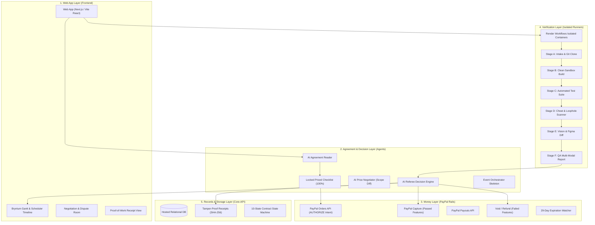

# PactPal System Architecture

## Overview
PactPal is a Zero-Trust Multimodal Escrow Referee for Digital Freelancing. It resolves the freelancer trust gap by acting as an impartial, automated referee between buyers and sellers. It translates signed contracts into measurable feature checklists, locks buyer funds in escrow via PayPal authorization, executes isolated multi-stage verification in Render Workflows, and releases funds proportionately backed by cryptographic proof-of-work receipts.

---

## 5-Layer Architectural Stack

---

## Subsystem Breakdown & Directory Mapping

| Directory | Subsystem | Owner / Stream | Key Responsibilities |
| :--- | :--- | :--- | :--- |
| `frontend/` | Web App & Timeline | **Frontend (FE)** | Buyer/Seller dashboards, contract creation wizard, Bryntum Gantt timelines, real-time activity feed. |
| `services/agents/` | AI Agents & Decision Engine | **Agreement / Negotiation (AG)** | Form parsing to priced checklists, cheat scan prompts, visual comparison prompts, referee rules, price negotiation. |
| `services/core-api/` | Central Backend & Database | **Agreement / Negotiation (AG)** | Relational data schema (users, contracts, features, payments, receipts), 10-state machine, REST API. |
| `services/verification/` | Isolated Verification Pipeline | **Verification (VR)** | Render Workflows triggers, Stages A-F orchestration, headless browser screenshot capture, visual difference reports. |
| `services/payments/` | Payment Rails & Escrow | **Payments (PAY)** | PayPal Orders API (Authorize), Capture, Payouts, Refund, webhook verification, 29-day expiry countdown. |
| `shared/` | Cross-Service Contracts | **All Teams** | Shared TypeScript interfaces, JSON schemas, state machine enums. |
| `demo-assets/` | Hackathon Demo Assets | **All Teams** | Sample Figma designs, clean "good-repo", flawed "bad-repo". |

