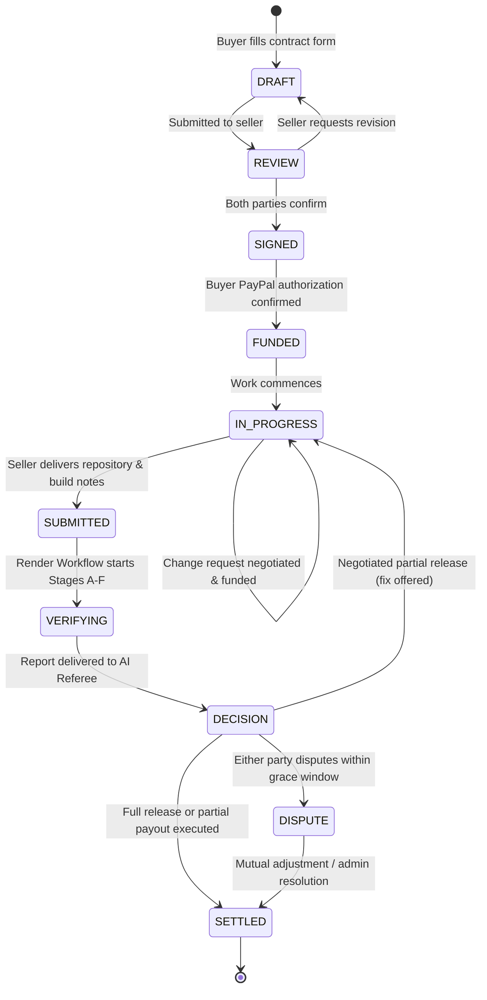

# PactPal Contract Life Cycle: 10-State Master Flow

Every contract in PactPal exists in exactly one state at any given point in time. This guarantees strict deterministic guarantees, prevents race conditions in funds release, and powers the Bryntum Gantt chart timeline.

---

## State Transition Diagram

---

## State Definitions & Triggers

| # | State | Description | Allowed Actions & Triggers |
| :--- | :--- | :--- | :--- |
| 1 | `DRAFT` | Buyer completes structured contract form with features, weights, and tests. | Buyer edits; sends to seller for review. |
| 2 | `REVIEW` | Seller reviews feature requirements, price breakdown, and deadlines. | Seller accepts or counters. |
| 3 | `SIGNED` | Dual timestamped confirmation recorded. AI Agreement Reader locks checklist. | Weights sum to 100%, tests verified; triggers payment prompt. |
| 4 | `FUNDED` | Buyer approves PayPal hold (AUTHORIZE intent). Funds reserved. | Authorization ID logged; 29-day expiry countdown starts. |
| 5 | `IN_PROGRESS` | Freelancer works on milestone. Change requests can be negotiated. | Negotiator can spawn mini-agreements with incremental holds. |
| 6 | `SUBMITTED` | Freelancer submits repository link, commit hash, and build notes. | Timestamp checked against contract deadline. |
| 7 | `VERIFYING` | Render Workflow isolated container executes Stages A to F. | Build -> Tests -> Cheat Scan -> Visual Diff -> Report. |
| 8 | `DECISION` | AI Referee applies transparent rules to verification report. | Full release, partial release, or fix offer dispatched. |
| 9 | `SETTLED` | PayPal capture of passed weight, void/refund of remaining; receipt hashed. | Immutable SHA-256 receipt stored; contract closed. |
| 10 | `DISPUTE` | Optional state if buyer or seller flags evidence discrepancy. | Referee holds balance; presents audit trail & chat logs. |

