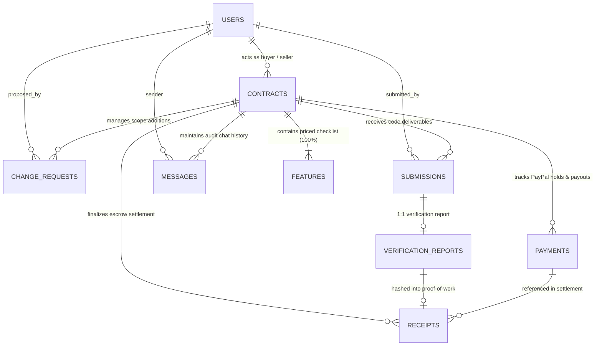

# PactPal One-Page Relational Data Map & Schema Specification

## 1. Executive Summary & Zero-Trust Relational Model
PactPal functions as an automated, impartial AI Escrow Referee between digital freelance buyers and sellers. To enforce zero-trust guarantees, ensure auditable milestone delivery, and power the Bryntum Gantt timeline, the relational persistence model connects **9 core entities**:
- **`users`**: Buyers, sellers, and platform administrators.
- **`contracts`**: Root milestone contracts managing the 10-state lifecycle and PayPal holding authorizations.
- **`features`**: The priced checklist items derived by the Agreement Reader; feature weights sum to exactly 100%.
- **`change_requests`**: Mid-project scope additions negotiated by the AI Price Negotiator.
- **`submissions`**: Code deliveries submitted by the seller for verification.
- **`verification_reports`**: Multimodal evaluation reports produced in isolated Render Workflows containers.
- **`payments`**: PayPal financial records tracking authorization holds, captures, payouts, and refunds.
- **`receipts`**: Cryptographic, tamper-evident SHA-256 proof-of-work receipts closing the escrow settlement.
- **`messages`**: Multi-party audit trail and negotiation chat between Buyer, Seller, and AI Referee.

---

## 2. Entity Relationship Diagram (ERD)

---

## 3. Detailed Entity Dictionary (The 9 Core Entities)

### 3.1 `users`
Represents participating actors on the platform.
* `id` (`UUID`, PK): Unique user identifier.
* `role` (`VARCHAR(20)`, NOT NULL): `BUYER`, `SELLER`, or `ADMIN`.
* `name` (`VARCHAR(255)`, NOT NULL): Display name.
* `email` (`VARCHAR(255)`, UNIQUE, NOT NULL): Primary communication email.
* `paypal_email` (`VARCHAR(255)`, NULL): PayPal account email required for receiving payouts.
* `created_at` (`TIMESTAMPTZ`, DEFAULT NOW()): Account registration timestamp.
* `updated_at` (`TIMESTAMPTZ`, DEFAULT NOW()): Last modification timestamp.

### 3.2 `contracts`
The central escrow agreement binding a buyer, a seller, a total price, and a deadline.
* `id` (`UUID`, PK): Unique contract identifier.
* `buyer_id` (`UUID`, FK -> `users.id`, NOT NULL): The client funding the escrow.
* `seller_id` (`UUID`, FK -> `users.id`, NOT NULL): The freelancer executing the work.
* `title` (`VARCHAR(255)`, NOT NULL): Milestone / project title.
* `description` (`TEXT`, NOT NULL): High-level agreement scope.
* `status` (`VARCHAR(30)`, NOT NULL): 10-state enum:
  `DRAFT`, `REVIEW`, `SIGNED`, `FUNDED`, `IN_PROGRESS`, `SUBMITTED`, `VERIFYING`, `DECISION`, `SETTLED`, `DISPUTE`.
* `total_amount` (`NUMERIC(10, 2)`, NOT NULL, CHECK >= 0): Total contract value in escrow.
* `currency` (`VARCHAR(3)`, DEFAULT 'USD'): ISO 4217 currency code.
* `deadline` (`TIMESTAMPTZ`, NOT NULL): Milestone delivery cutoff date/time.
* `paypal_order_id` (`VARCHAR(100)`, UNIQUE, NULL): PayPal Orders API reference.
* `paypal_auth_id` (`VARCHAR(100)`, UNIQUE, NULL): PayPal Authorization ID holding the buyer's funds.
* `auth_expires_at` (`TIMESTAMPTZ`, NULL): PayPal 29-day authorization hold expiration cutoff.
* `figma_url` (`TEXT`, NULL): Figma benchmark URL for Stage E visual comparison.
* `repo_url` (`TEXT`, NULL): Source code repository link.
* `created_at` (`TIMESTAMPTZ`, DEFAULT NOW()): Creation timestamp.
* `updated_at` (`TIMESTAMPTZ`, DEFAULT NOW()): Last updated timestamp.

### 3.3 `features`
Priced checklist items parsed by the AI Agreement Reader.
* `id` (`UUID`, PK): Unique feature identifier.
* `contract_id` (`UUID`, FK -> `contracts.id` ON DELETE CASCADE, NOT NULL): Parent contract.
* `title` (`VARCHAR(255)`, NOT NULL): Feature title / scope description.
* `acceptance_test` (`TEXT`, NOT NULL): Plain-language, measurable pass/fail test description.
* `price_weight` (`NUMERIC(5, 2)`, NOT NULL, CHECK 0..100): Percentage weight of contract total.
* `allocated_amount` (`NUMERIC(10, 2)`, NOT NULL, CHECK >= 0): Dollar allocation (`total_amount * weight / 100`).
* `status` (`VARCHAR(20)`, DEFAULT 'PENDING', NOT NULL): `PENDING`, `PASSED`, `FAILED`, `DISPUTED`.
* `sort_order` (`INT`, DEFAULT 0, NOT NULL): UI display sequence for checklist and Gantt tasks.
* `created_at` (`TIMESTAMPTZ`, DEFAULT NOW()): Creation timestamp.
* `updated_at` (`TIMESTAMPTZ`, DEFAULT NOW()): Last updated timestamp.

### 3.4 `change_requests` (`changes`)
Scope, price, and deadline adjustments negotiated mid-project via the AI Price Negotiator.
* `id` (`UUID`, PK): Unique change request identifier.
* `contract_id` (`UUID`, FK -> `contracts.id` ON DELETE CASCADE, NOT NULL): Parent contract.
* `proposed_by_id` (`UUID`, FK -> `users.id`, NOT NULL): Actor initiating the change.
* `description` (`TEXT`, NOT NULL): Scope difference or new requirements.
* `proposed_price` (`NUMERIC(10, 2)`, NOT NULL): Proposed additional escrow funding.
* `proposed_extra_time_hours` (`INT`, DEFAULT 0, NOT NULL): Extension in delivery deadline.
* `ai_reasoning` (`TEXT`, NULL): AI Price Negotiator evaluation, market comparison, and rationale.
* `status` (`VARCHAR(20)`, DEFAULT 'PROPOSED', NOT NULL): `PROPOSED`, `ACCEPTED`, `REJECTED`, `COUNTERED`.
* `additional_auth_id` (`VARCHAR(100)`, NULL): PayPal Authorization ID for incremental hold.
* `created_at` (`TIMESTAMPTZ`, DEFAULT NOW()): Creation timestamp.
* `updated_at` (`TIMESTAMPTZ`, DEFAULT NOW()): Last updated timestamp.

### 3.5 `submissions`
Deliverables submitted by the seller for verification.
* `id` (`UUID`, PK): Unique submission identifier.
* `contract_id` (`UUID`, FK -> `contracts.id` ON DELETE CASCADE, NOT NULL): Target contract.
* `seller_id` (`UUID`, FK -> `users.id`, NOT NULL): Freelancer submitting code.
* `repo_url` (`TEXT`, NOT NULL): Git repository URL.
* `commit_sha` (`VARCHAR(64)`, NOT NULL): Immutable commit SHA verified in the sandbox.
* `build_notes` (`TEXT`, NULL): Seller instructions for building the project.
* `submission_number` (`INT`, DEFAULT 1, NOT NULL, CHECK 1..3): Resubmission attempt count.
* `is_late` (`BOOLEAN`, DEFAULT FALSE, NOT NULL): Flags if submission timestamp exceeded deadline.
* `submitted_at` (`TIMESTAMPTZ`, DEFAULT NOW()): Submission timestamp.

### 3.6 `verification_reports` (`reports`)
Multimodal verification outcomes generated inside isolated Render Workflows containers.
* `id` (`UUID`, PK): Unique report identifier.
* `submission_id` (`UUID`, FK -> `submissions.id` ON DELETE CASCADE, UNIQUE, NOT NULL): 1:1 submission mapping.
* `contract_id` (`UUID`, FK -> `contracts.id` ON DELETE CASCADE, NOT NULL): Target contract.
* `render_job_id` (`VARCHAR(100)`, NULL): Render Ephemeral Job ID.
* `build_succeeded` (`BOOLEAN`, NOT NULL): Stage B clean build result.
* `build_logs` (`TEXT`, NULL): Build execution stdout/stderr excerpt.
* `test_suite_results` (`JSONB`, NOT NULL): Stage C automated unit/integration test results.
* `cheat_scan_findings` (`JSONB`, NOT NULL): Stage D security scan (HIGH/MED/LOW severity findings).
* `visual_diff_summary` (`JSONB`, NOT NULL): Stage E visual comparison against Figma design.
* `per_feature_results` (`JSONB`, NOT NULL): Stage F pass/fail/partial mapping per checklist feature.
* `overall_score` (`NUMERIC(4, 3)`, NULL, CHECK 0..1): Normalized aggregate quality score.
* `completed_at` (`TIMESTAMPTZ`, DEFAULT NOW()): Report completion timestamp.

### 3.7 `payments`
Immutable ledger of PayPal escrow transactions.
* `id` (`UUID`, PK): Unique payment record identifier.
* `contract_id` (`UUID`, FK -> `contracts.id` ON DELETE RESTRICT, NOT NULL): Associated contract.
* `payment_type` (`VARCHAR(20)`, NOT NULL): `AUTHORIZATION`, `CAPTURE`, `PAYOUT`, `REFUND`, `VOID`.
* `paypal_reference_id` (`VARCHAR(100)`, NOT NULL): PayPal Order/Auth/Capture/Payout/Refund ID.
* `amount` (`NUMERIC(10, 2)`, NOT NULL, CHECK > 0): Transaction monetary value.
* `currency` (`VARCHAR(3)`, DEFAULT 'USD', NOT NULL): ISO currency code.
* `status` (`VARCHAR(20)`, NOT NULL): `PENDING`, `COMPLETED`, `FAILED`.
* `metadata` (`JSONB`, NULL): Raw PayPal webhook or response payload.
* `processed_at` (`TIMESTAMPTZ`, DEFAULT NOW()): Transaction execution timestamp.

### 3.8 `receipts`
Tamper-evident, cryptographically hashed proof-of-work receipts (Phase 8 Differentiator).
* `id` (`UUID`, PK): Unique receipt identifier.
* `contract_id` (`UUID`, FK -> `contracts.id` ON DELETE RESTRICT, NOT NULL): Associated contract.
* `report_id` (`UUID`, FK -> `verification_reports.id` ON DELETE RESTRICT, NOT NULL): Verified evidence report.
* `payment_id` (`UUID`, FK -> `payments.id` ON DELETE RESTRICT, NULL): Settlement payment transaction.
* `receipt_hash` (`VARCHAR(64)`, NOT NULL): SHA-256 fingerprint computed over canonical verification summary.
* `summary_text` (`TEXT`, NOT NULL): Human-readable settlement justification.
* `passed_features_count` (`INT`, NOT NULL): Count of verified checklist items.
* `total_features_count` (`INT`, NOT NULL): Total checklist items evaluated.
* `seller_payout_amount` (`NUMERIC(10, 2)`, NOT NULL, CHECK >= 0): Amount disbursed to seller.
* `buyer_refund_amount` (`NUMERIC(10, 2)`, NOT NULL, CHECK >= 0): Amount refunded to buyer.
* `verification_fingerprint_payload` (`JSONB`, NOT NULL): Canonical JSON payload used for SHA-256 verification.
* `issued_at` (`TIMESTAMPTZ`, DEFAULT NOW()): Issuance timestamp.

### 3.9 `messages`
Audit history, negotiation dialogue, and referee announcements.
* `id` (`UUID`, PK): Unique message identifier.
* `contract_id` (`UUID`, FK -> `contracts.id` ON DELETE CASCADE, NOT NULL): Context contract.
* `sender_id` (`UUID`, FK -> `users.id` ON DELETE SET NULL, NULL): User sender (NULL for AI Referee).
* `sender_type` (`VARCHAR(20)`, NOT NULL): `BUYER`, `SELLER`, `AI_REFEREE`, `ADMIN`.
* `content` (`TEXT`, NOT NULL): Message body.
* `metadata` (`JSONB`, NULL): Structured data (e.g., mini-agreement offer card, quick actions).
* `sent_at` (`TIMESTAMPTZ`, DEFAULT NOW()): Message dispatch timestamp.

---

## 4. Relational Integrity, Foreign Keys & Cascade Policies

| Parent Table | Child Table | Foreign Key Column | Cardinality | Delete Action | Reason |
| :--- | :--- | :--- | :--- | :--- | :--- |
| `users` | `contracts` | `buyer_id` | 1 : N | `RESTRICT` | Cannot delete a user with active contracts. |
| `users` | `contracts` | `seller_id` | 1 : N | `RESTRICT` | Cannot delete a user with active contracts. |
| `contracts` | `features` | `contract_id` | 1 : N | `CASCADE` | Features belong exclusively to a contract. |
| `contracts` | `change_requests` | `contract_id` | 1 : N | `CASCADE` | Changes belong to the contract context. |
| `contracts` | `submissions` | `contract_id` | 1 : N | `CASCADE` | Submissions belong to the contract. |
| `submissions` | `verification_reports` | `submission_id` | 1 : 1 | `CASCADE` | Report evaluates exactly one submission. |
| `contracts` | `payments` | `contract_id` | 1 : N | `RESTRICT` | Financial records must **never** be silently deleted. |
| `contracts` | `receipts` | `contract_id` | 1 : N | `RESTRICT` | Proof-of-work receipts must remain immutable. |
| `verification_reports`| `receipts` | `report_id` | 1 : 1 | `RESTRICT` | Receipt permanently links to the verification report. |
| `contracts` | `messages` | `contract_id` | 1 : N | `CASCADE` | Audit chat cascades with contract deletion. |

---

## 5. Mathematical & Business Invariants

1. **Checklist Weight Sum Rule**: For any contract with status in (`SIGNED`, `FUNDED`, `IN_PROGRESS`, `SUBMITTED`, `VERIFYING`, `DECISION`, `SETTLED`), the sum of `features.price_weight` must equal exactly `100.00%`.
2. **Escrow Conservation Law**: At settlement, `seller_payout_amount + buyer_refund_amount == contracts.total_amount`.
3. **Resubmission Boundary**: `submissions.submission_number` is restricted to between `1` and `3` to prevent infinite review loops.
4. **PayPal Authorization Expiry**: `contracts.auth_expires_at` is set to `created_at + INTERVAL '29 days'`, triggering automated timeline warnings on the Bryntum Gantt view.
