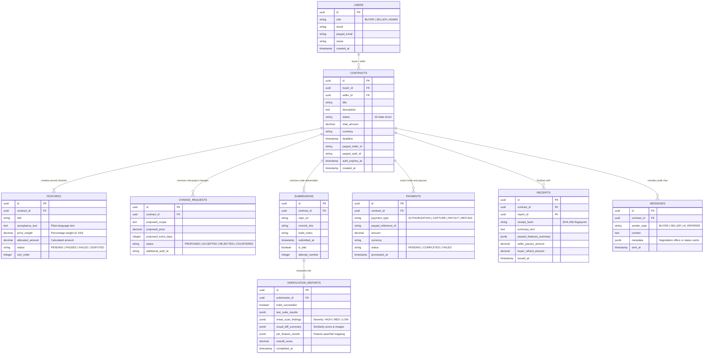

# PactPal One-Page Relational Data Map (Schema Specification)

This data map defines the core relational database entities for PactPal, connecting contracts, priced features, verification artifacts, PayPal payments, and cryptographic receipts.

---

## Entity Relationship Overview

